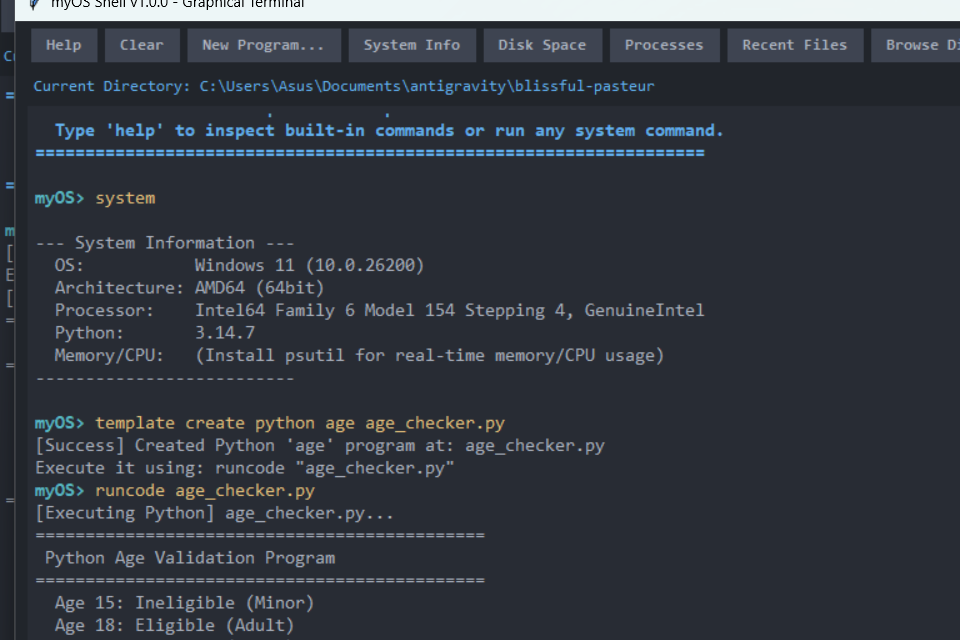
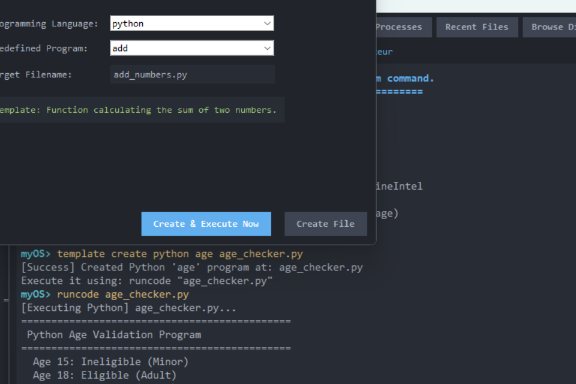

# myOS Modular Shell Project

[](https://www.python.org/downloads/)
[]()
[](LICENSE)

A production-grade, highly modular Unix-like Operating System Shell engineered in Python following **SOLID design principles**, process isolation, POSIX signal semantics, IPC pipeline chaining, file descriptor redirection, dynamic plugin-style built-in command registration, and an ANSI colorized dynamic prompt with tab autocompletion.

Originally authored by **Arpit Tiwari** as a monolithic prototype (`one.py`), this repository has been refactored and re-architected into an enterprise-ready, maintainable, extensible systems software package.

---

## Graphical User Interface (GUI) Preview

<div align="center">
  
  <p><em>myOS Terminal Desktop Interface with One Dark Theme, System Telemetry, and Live Execution</em></p>
</div>

<br/>

<div align="center">
  
  <p><em>Code Studio: Interactive Dialog to Scaffold & Execute Predefined Programs (Python, C, C++, Java, JS)</em></p>
</div>

---

## 1. Architectural Highlights & SOLID Implementation

```
                                  +-------------------+
                                  |    shell/main.py  |  (REPL Entry Point)
                                  +---------+---------+
                                            |
                         +------------------+------------------+
                         |                                     |
                         v                                     v
               +-------------------+                 +-------------------+
               |  core/parser.py   |                 |    ui/prompt.py   |
               | (Lexer & AST Gen) |                 |   ui/completer.py |
               +---------+---------+                 +-------------------+
                         |
                         v [Parsed Statements]
               +-------------------+
               |  core/executor.py | <-----------------+
               +---------+---------+                   |
                         |                             |
          +--------------+---------------+             |
          |                              |             |
          v                              v             |
+-------------------+          +-------------------+   |
|   builtins/       |          |    sys_ops/       |   |
| (Registry Pattern)|          | - signals.py      |   |
| - BaseBuiltin     |          | - io_redirect.py  |   |
| - navigation.py   |          | - pipelines.py    |   |
| - file_ops.py     |          +---------+---------+   |
| - process_ctrl.py |                    |             |
| - env_ops.py      |                    +-------------+
| - sys_info.py     |
+---------+---------+
          |
          v
+-------------------+
|   core/context.py | (Encapsulated Runtime State: env, cwd, history, jobs, streams)
+-------------------+
```

### Architectural Principles Applied

1. **Single Responsibility Principle (SRP):**
   - `core/parser.py`: Solely handles lexical tokenization, quoting, variable expansion (`$VAR`, `$?`, `~`), and abstract syntax tree generation.
   - `core/context.py`: Encapsulates all mutable session state (directory stack, environment variables, job table, last exit status, stream abstractions).
   - `core/executor.py`: Exclusively coordinates process execution, conditional execution (`&&`, `||`, `;`), and command dispatch.
   - `sys_ops/signals.py`: Handles low-level signal trapping (`SIGINT`, `SIGTSTP`, `SIGCHLD`) ensuring process isolation.
   - `sys_ops/io_redirect.py`: Manages low-level file descriptor duplication (`dup2`) and stream routing (`<`, `>`, `>>`, `2>`, `&>`).
   - `sys_ops/pipelines.py`: Orchestrates multi-stage IPC pipes (`cmd1 | cmd2 | cmd3`).

2. **Open-Closed Principle (OCP):**
   - Built-in commands adhere to the **Strategy & Registry Pattern**. Adding a new command requires only subclassing `BaseBuiltin` with the `@register_builtin` decorator. No modifications to `main.py` or `executor.py` are needed.

3. **Liskov Substitution Principle (LSP):**
   - All built-in commands implement the `BaseBuiltin` contract (`execute(args, context) -> int`). Any command can be substituted and invoked uniformly by the execution engine and pipeline runner.

4. **Interface Segregation Principle (ISP):**
   - Interfaces between the parser, executor, prompt renderer, and signal manager are lean and decoupled.

5. **Dependency Inversion Principle (DIP):**
   - High-level modules (the REPL loop and executor) depend on abstract stream interfaces and context objects rather than global runtime state (`sys.stdin`, `os.environ`, or OS file descriptors).

---

## 2. Directory Layout

```
shell_project/
│
├── shell/
│   ├── __init__.py              # Package metadata and versioning
│   ├── main.py                  # Entry point / REPL loop orchestrator
│   │
│   ├── core/                    # Core shell mechanics
│   │   ├── __init__.py
│   │   ├── parser.py            # Command lexer, argument parsing, quotes/escaping
│   │   ├── executor.py          # Process creation (fork/exec), external commands, execution
│   │   ├── context.py           # Shell state (environment, exit codes, working dir, jobs)
│   │   └── history.py           # Command history management and persistent recall
│   │
│   ├── builtins/                # Native shell built-in commands
│   │   ├── __init__.py
│   │   ├── base.py              # BaseBuiltin abstract class / interface
│   │   ├── registry.py          # Dynamic builtin registration and lookup
│   │   ├── navigation.py        # cd, pwd, dirs, pushd, popd
│   │   ├── file_ops.py          # ls, cat/view, touch/create, rm, mkdir, cp, mv, find, recent
│   │   ├── process_ctrl.py      # exit/quit, kill, ps, jobs, fg, bg
│   │   ├── env_ops.py           # export, set, unset, env, alias, aliases, unalias, echo
│   │   └── sys_info.py          # system, disk, ip, clear, history, help
│   │
│   ├── sys_ops/                 # Low-level OS interactions
│   │   ├── __init__.py
│   │   ├── signals.py           # Signal handling (SIGINT/Ctrl+C, SIGTSTP/Ctrl+Z, SIGCHLD)
│   │   ├── io_redirect.py       # File descriptor duplication (stdin/stdout/stderr, >, >>, <, 2>)
│   │   └── pipelines.py         # IPC pipes between chained commands (|)
│   │
│   └── ui/                      # Presentation layer
│       ├── __init__.py
│       ├── prompt.py            # Dynamic prompt generator (user@host:path$ + git branch)
│       ├── completer.py         # Readline tab auto-completion for paths and commands
│       └── gui.py               # Modern Tkinter desktop graphical terminal interface
│
├── tests/                       # Complete unit and integration test suite
│   ├── __init__.py
│   ├── test_parser.py           # Lexer, quoting, variables, redirections, AST tests
│   ├── test_builtins.py         # Unit tests for all native commands
│   ├── test_pipelines.py        # IPC pipes, stdin/stdout chaining tests
│   ├── test_executor.py         # Process isolation, redirections, conditionals tests
│   └── test_gui.py              # Tkinter GUI and stream queuing tests
│
├── legacy/                      # Preserved monolithic prototype
│   └── one.py                   # Original single-file implementation
│
├── pyproject.toml               # Modern packaging metadata (PEP 517/621)
├── requirements.txt             # Dependencies
└── README.md                    # Project documentation
```

---

## 3. Supported Features & Built-in Commands

### Navigation & Directory Stack
- `cd [dir | ~ | -]` : Change directory with home and previous directory support.
- `pwd` : Print current working directory.
- `dirs` : Show directory stack.
- `pushd <dir>` : Push directory onto stack and change directory.
- `popd` : Pop top directory from stack and return to it.

### File Operations
- `ls [-a] [-l] [path...]` : List directory entries with permissions, sizes, and timestamps.
- `cat / view <file...>` : Display file contents (or read from piped standard input).
- `touch / create <file...>` : Update timestamps or create empty files.
- `mkdir [-p] <dir...>` : Create single or nested directories.
- `rm [-r] [-f] <file/dir...>` : Remove files or recursive directories.
- `cp [-r] <source> <dest>` : Copy files or directories.
- `mv <source> <dest>` : Move/rename files or directories.
- `find [path] <pattern>` : Recursively locate files matching a pattern.
- `recent [N]` : List the N most recently modified files in the current folder.

### Process & Job Control
- `ps` : Display running process snapshot (uses `psutil` if present, with system fallback).
- `kill [-signal] <pid...>` : Send signals to target processes.
- `jobs` : List active background jobs.
- `fg [job_id]` : Bring background process to foreground.
- `bg [job_id]` : Resume stopped background job.
- `exit / quit [code]` : Terminate the shell session with optional exit code.

### Environment & Aliasing
- `export [KEY=VALUE...]` : Export environment variables.
- `set [KEY=VALUE...]` : Set local shell variables or list all variables.
- `unset <KEY...>` : Remove environment or shell variables.
- `env` : Dump exported environment variables.
- `alias [name='cmd']` : Define command aliases.
- `aliases` : Display all active aliases.
- `unalias <name...>` : Remove defined aliases.
- `echo [-n] [-e] [arg...]` : Output arguments with variable and escape expansion.

### System Diagnostics
- `system` : Print OS, CPU architecture, processor, Python version, RAM, and CPU usage.
- `disk [path]` : Inspect disk capacity, used space, and free space.
- `ip` : Display hostname, local IP, and public WAN IP.
- `clear` : Clear terminal screen.
- `history [-c]` : View or clear command history.
- `help [command]` : Interactive documentation generated dynamically from the registry.

### Code Generation & Multi-Language Execution
- `template [list | create <lang> <template> [filename]]` : Generate predefined programs in Python, C, C++, Java, or JavaScript.
  - Templates supported: `add` (Addition program), `age` (Age validation & voting eligibility), `hello` (Hello World).
- `runcode <filename> [args...]` : Compile and execute source files seamlessly (`.py`, `.c`, `.cpp`, `.java`, `.js`) with live stream output.

### Advanced Shell Mechanics
- **Pipes (`|`)**: Arbitrary multi-stage piping between builtins and external binaries (e.g. `cat file.txt | grep pattern | wc -l`).
- **Redirection**:
  - `> file` / `1> file` : Overwrite stdout
  - `>> file` / `1>> file` : Append stdout
  - `< file` / `0< file` : Redirect stdin
  - `2> file` : Redirect stderr
  - `2>> file` : Append stderr
  - `&> file` : Redirect both stdout and stderr
  - `2>&1` : Duplicate stdout to stderr
- **Chaining**: Conditional execution using `&&`, `||`, and `;`.
- **Background Execution (`&`)**: Run jobs asynchronously in the background.
- **Variable Expansion**: Expands `$VAR`, `${VAR}`, `$?` (exit code), and `~`.
- **Signal Isolation**: Pressing `Ctrl+C` interrupts child processes without terminating the interactive shell.

---

## 4. Installation & Usage Instructions

### Prerequisites
- Python 3.8 or higher.
- Optional dependencies: `psutil` (for system metrics), `pyreadline3` (for Windows tab-completion).

### Installation

1. **Clone or navigate to the repository:**
   ```bash
   cd shell_project
   ```

2. **Install dependencies:**
   ```bash
   pip install -r requirements.txt
   ```

3. **Install the shell package in editable development mode:**
   ```bash
   pip install -e .
   ```

---

## 5. Running the Shell

### Interactive Mode (REPL)
Launch the interactive shell with styled prompt and tab completion:

```bash
# Using Python module
python -m shell.main

# Or if installed via pip:
shell-project
# or
myos
```

### Graphical Desktop Interface Mode (Tkinter GUI)
Launch the modern desktop graphical terminal window:

```bash
# Using --gui flag
python -m shell.main --gui

# Or launching the GUI module directly:
python -m shell.ui.gui
```
*Features quick action toolbar buttons (Help, Clear, System Info, Disk Space, Process Monitor, Folder Browser), asynchronous worker threads, ANSI color rendering, and command history recall.*

### Non-Interactive Command Execution (`-c`)
Execute a single command string and return its exit code:

```bash
python -m shell.main -c "echo 'Modular Shell' | python -c 'import sys; print(sys.stdin.read().strip())'"
```

### Executing a Shell Script File
Execute a script containing multiple shell commands:

```bash
python -m shell.main script.sh
```

---

## 6. Running the Test Suite

The test suite covers lexical analysis, quoting, variable expansion, built-ins, process execution, conditional execution, redirections, and multi-stage pipelines.

Execute the tests using standard library `unittest`:
```bash
python -m unittest discover -s tests -t .
```

Or using `pytest` with coverage:
```bash
pytest --cov=shell tests/
```
